<div align="center">

  <!-- Terminal-Inspired Hero Banner Card -->
  <a href="https://github.com/shantanu-walia">
    
  </a>

</div>

---

##  &nbsp;About Me

```js
const shantanu = {
  role: "Software Developer",
  focus: ["Backend", "Full-Stack", "DSA", "Open Source"],
  stack: ["C++", "JavaScript", "TypeScript", "React", "Node.js", "Express.js", "Prisma"],
  databases: ["MongoDB", "PostgreSQL"],
  tools: ["Git", "GitHub", "Docker"],
  philosophy: "Build. Learn. Solve. Improve."
};
```

I’m a software developer focused on backend and full-stack development. I enjoy building real-world projects, working with APIs and databases, and solving problems through Data Structures & Algorithms. I’m constantly learning by building, debugging, and understanding how things work under the hood. I’m also exploring open source, system design, and modern developer tools as I grow into a better engineer.

---

##  &nbsp;Tech Stack

<!-- Developer Laptop Automatic Tech Stack Typing Animation (Midnight Finish) -->
<p align="center">
  
</p>

<br/>

<p align="center">
  <a href="https://isocpp.org/" target="_blank" rel="noreferrer"></a>
  <a href="https://developer.mozilla.org/en-US/docs/Web/JavaScript" target="_blank" rel="noreferrer"></a>
  <a href="https://www.typescriptlang.org/" target="_blank" rel="noreferrer"></a>
  <a href="https://react.dev/" target="_blank" rel="noreferrer"></a>
  <a href="https://tailwindcss.com/" target="_blank" rel="noreferrer"></a>
  <a href="https://nodejs.org/" target="_blank" rel="noreferrer"></a>
  <a href="https://expressjs.com/" target="_blank" rel="noreferrer"></a>
  <a href="https://www.mongodb.com/" target="_blank" rel="noreferrer"></a>
  <a href="https://www.postgresql.org/" target="_blank" rel="noreferrer"></a>
  <a href="https://www.prisma.io/" target="_blank" rel="noreferrer"></a>
  <a href="https://www.docker.com/" target="_blank" rel="noreferrer"></a>
  <a href="https://git-scm.com/" target="_blank" rel="noreferrer"></a>
  <a href="https://github.com/" target="_blank" rel="noreferrer"></a>
</p>

---

##  &nbsp;Connect With Me

<p align="center">
  <a href="https://github.com/shantanu-walia" target="_blank" rel="noopener"></a>
  <a href="https://in.linkedin.com/in/shantanu-walia-45414a36a" target="_blank" rel="noopener"></a>
  <a href="https://leetcode.com/u/Shanu313/" target="_blank" rel="noopener"></a>
  <a href="mailto:waliashantanu3@gmail.com"></a>
</p>
